# Red Clover Studio

**A free production studio for AI films and microdramas that runs on your own computer.**
Script in, finished cut out: cast and locations, storyboards, video takes, a playable rough cut,
sound, and a timeline you can finish in DaVinci Resolve.

[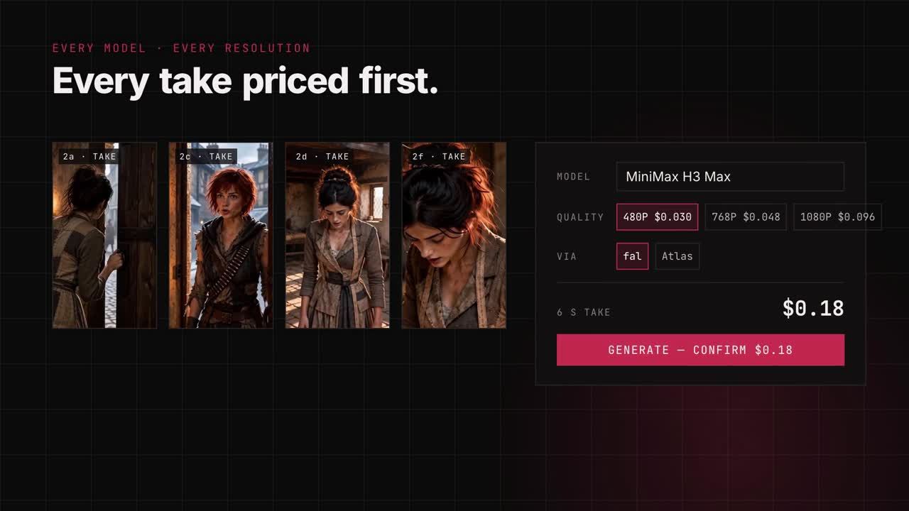](https://github.com/ShawnTheWriter/red-clover-studio/releases/download/v0.1.0-alpha/red-clover-studio-promo.mp4)

*Click the picture to watch the 57-second demo.*

**Full walkthrough (8 min):** install, then every stage of a real production, narrated.

[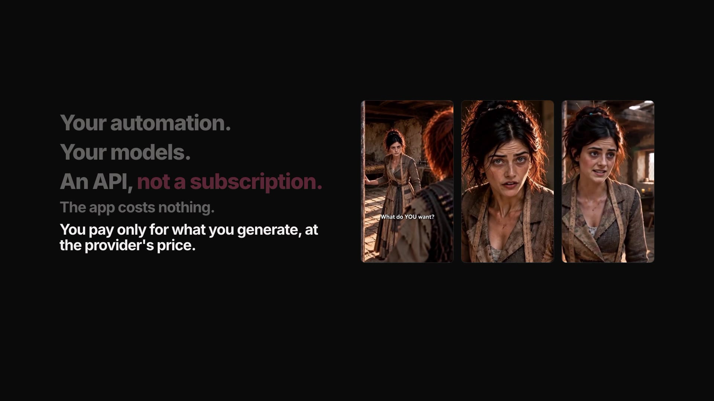](https://github.com/ShawnTheWriter/red-clover-studio/releases/download/v0.1.0-alpha/red-clover-studio-walkthrough.mp4)

<details><summary>Chapters</summary>

0:00 Free, no subscription · 0:18 Install · 0:30 The Library · 0:54 Connect your services ·
2:00 Script in · 2:32 The Vault · 3:28 Keyframes to video · 4:23 Your budget, enforced ·
4:54 Pick and trim · 5:27 Rough cut and sound · 6:40 Film out · 6:50 Remaster · 7:45 Wrap-up

</details>

> **Alpha.** Built for one filmmaker's real production and now shared. It works, it's tested
> (600+ automated checks), and it has rough edges. macOS is the only system tested so far.

## Easiest way to install (Mac, no Terminal needed)

1. On this page, click the green **Code** button → **Download ZIP**. Open the ZIP to unpack it.
2. Open the unpacked folder and double-click **Install and Open Red Clover Studio**.
   The first time, macOS may say it can't verify the file: right-click it → **Open** → **Open**.
3. If it says you need **Node.js**, it opens the download page. Install it, then double-click
   the file again.
4. The first run installs the app's parts (about a minute) and opens Red Clover Studio in your
   browser. Next time, just double-click the same file. Keep its window open while you work.

Video tools (**ffmpeg**) are needed for trimming, thumbnails and export. The app opens without
them; see Install below to add them. For developers, the command-line route is below.

## A tour, script to screen

Screens are from the sample's parent production, *Fashion Heist* S1E1: 41 shots, every video take
made in the app, **$53.99** in API spend against a $60 cap (that figure is the app's ledger,
checked against the real fal bill).

### The Library

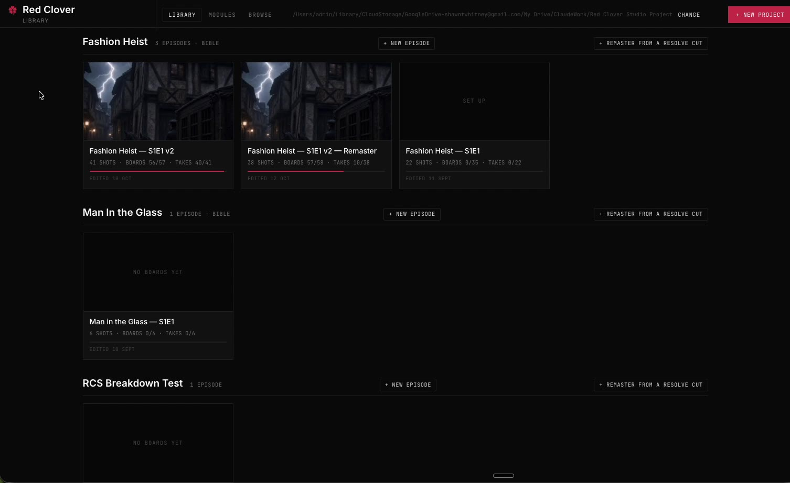

Where you start. Every production, series and episode in one place, each with a still from its own
assets. Start a new production or episode, or start a *remaster* from a Resolve cut (step 9).

### 1. Connect your services

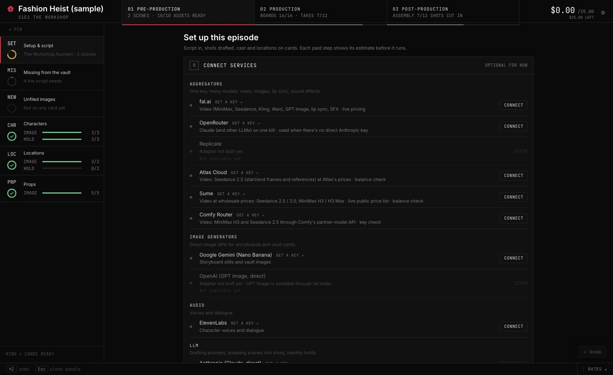

Add keys for the services you want, in one place: fal for video (MiniMax, Seedance, Kling, Wan),
GPT Image, lip sync, upscaling and sound effects; Atlas Cloud for Seedance 2.5 and Seedance 2.0 Fast/Mini at Atlas's prices; Sume for Seedance and MiniMax H3 at wholesale prices; Comfy Router
for MiniMax H3, Seedance and Nano Banana through Comfy's API; Google Gemini
for Nano Banana stills; ElevenLabs for voices; Anthropic or OpenRouter for the Claude helpers.
Keys stay on your computer and the app only ever shows their last four characters.

A price watch checks live prices every six hours, so quotes and your cap use current numbers.

**Cheapest route.** If two services you've connected sell the exact same model (same mode, tier and
quality), each take goes through the cheaper one at that moment, using live prices where the service
publishes them, and the quote shows the saving before you pay ("sent via Atlas at $0.330/s instead of
fal at $0.466/s"). It only compares like for like, never swaps one model for another, only uses services
you've connected, and records which route each take took. On by default; the CHEAPEST chip turns it off.
Today that covers Seedance on fal, Atlas Cloud and Sume (and MiniMax H3 / H3 Max on fal and Sume); new service adapters join automatically. The model picker
opens on the cheapest connected service for the model you chose.

### 2. Script in, shot list out

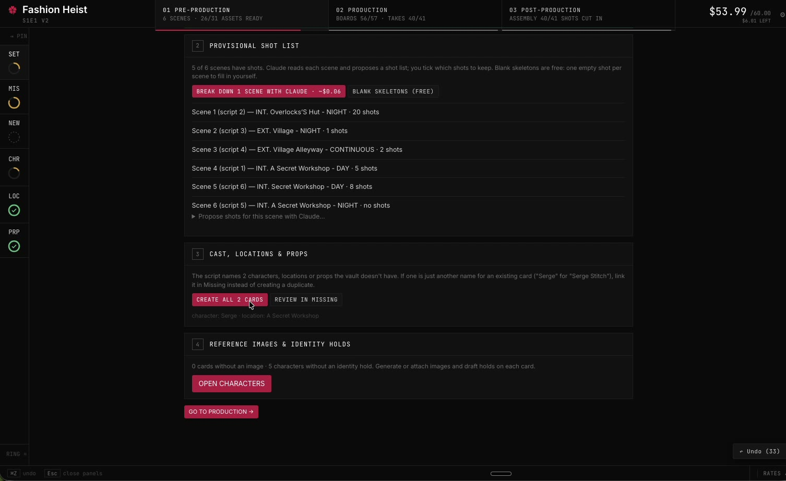

Upload a screenplay (.fdx, .fountain or .txt). The app reads the scenes from its sluglines, plus
the characters, locations and props. A Claude helper can draft a provisional shot list per scene
(the Fashion Heist one cost $0.06), and a *what's missing* check compares the script with the
cards you already have. You edit and approve; nothing is applied on its own.

### 3. The Vault: one card per character, location and prop

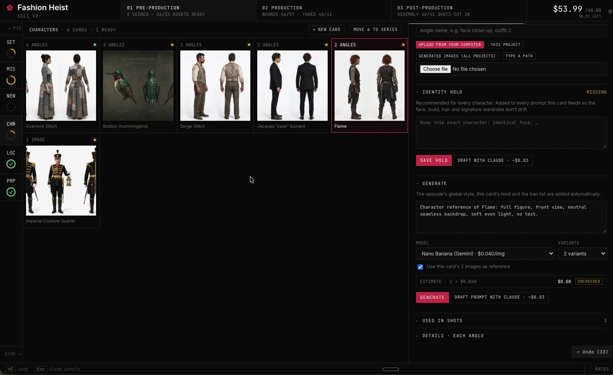

Face and full-body turnarounds, locations from several angles and times of day, props. Generate
them here or upload images from anywhere (ChatGPT, Midjourney, your own photos). Each card gets
an **identity hold**, a short description that the prompt helpers use to reinforce the reference
image, so a face or a set stays the same from shot to shot. In a series, the vault carries over to
every episode.

### 4. The board: storyboards and keyframes

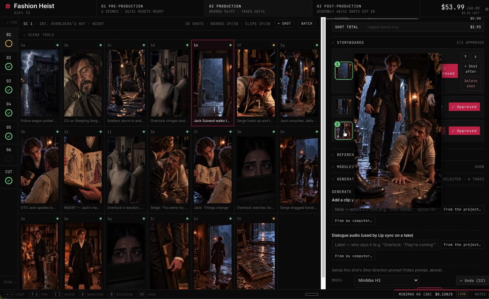

Every shot on one contact sheet, scene by scene, with a running count of boards and takes done.
Each shot can have a single keyframe or a first and last frame. Generate a few stills, pick your
start and end, or upload your own. Add reference images, or a reference video (Blender previs,
grey-box, an earlier take) to steer the camera.

### 5. Takes, priced before you click

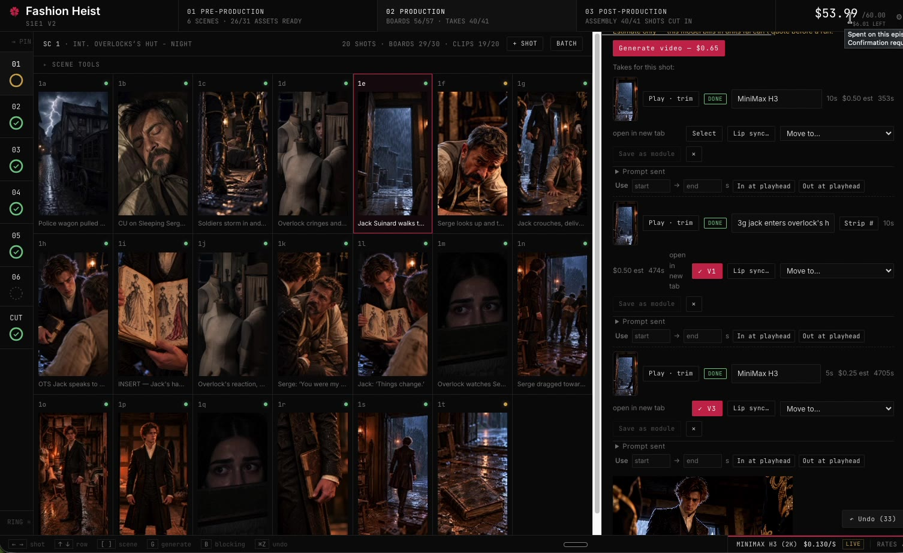

Choose the model, mode, tier and quality from short rows of choices. Every choice shows its price
per second, and the shot's quote is up front, based on duration, model and quality. The prompt you
see is exactly the prompt that's sent. Each take adds to the running total in the corner. Set a
**budget cap** for the episode: the app blocks anything that would go over it until you raise the
cap yourself.

**Draft, then finish.** On Atlas, Seedance 2.5 can make a 480p *draft* (measured: $0.134 per second) so you
can check that a move works. **Finish at 1080p** then re-renders that same draft at full quality. That finish is
expensive: Atlas quoted $6.53 for an 11 s draft (about $0.59 per second, an estimate until one is billed), several
times the draft. Upscaling the draft instead costs about $0.05 per second (SeedVR2 on fal; the Bytedance upscaler is also on Atlas, Atlas has its own upscaler, and Topaz is on Sume), so compare before you finish. Faces and
small detail are re-rendered by a finish, so check the result.

**Sound on or off.** On Seedance rows that have it (Atlas, and Comfy), a **Sound On | Off** switch turns the model's
generated sound off for a silent take, for one shot or for a whole batch. The price is the same either way.

**Cancel.** A queued or running take has a **Cancel** button. A take still waiting in the app's own queue is dropped for free; one already sent is cancelled at the service when the service still allows it (fal while it is waiting in its queue, Sume before it starts), and then it is not charged. If the service already started it, the take keeps running and the app says why. Generate also asks before queueing a second take on the same model for the same shot.

A take that is queued or running is marked red and pulses softly, so a submitted take is easy to see. A refused request
(a model refusal such as fal's 422) is not charged.

### 6. Pick the take, mark the part you want

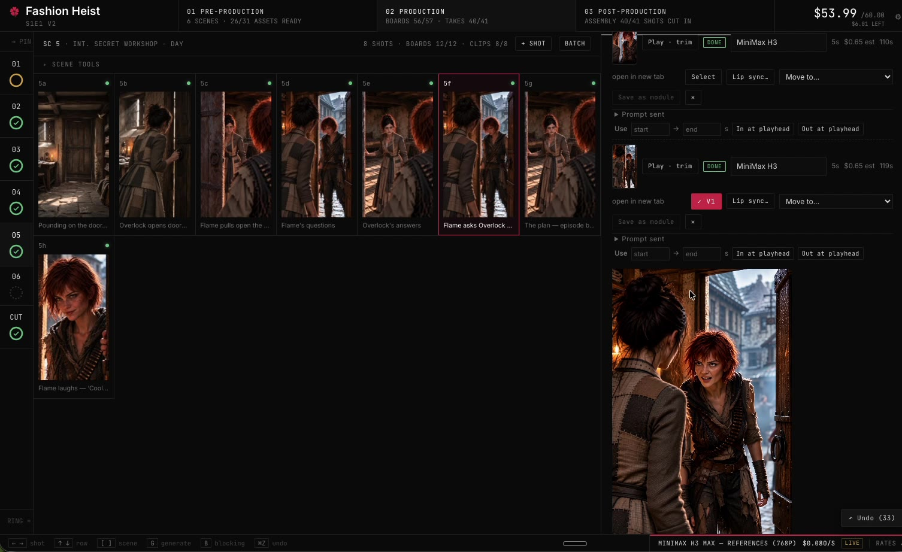

Compare a shot's takes, select the one you prefer, and mark in and out points so only that part
goes to the cut and the timeline. You can also **cut out a stretch from the middle** of a take (a cross-fade, a
stumble) and keep both sides: each kept piece becomes its own clip, and dialogue, sound effects and exports follow.
**Upscale** a take to 1080p (SeedVR2 or Bytedance, on fal) from the same panel; only the part you kept is sent and
paid for. Undo (⌘Z) never discards a take you paid for.

### 7. Sound: dialogue, effects, room tone

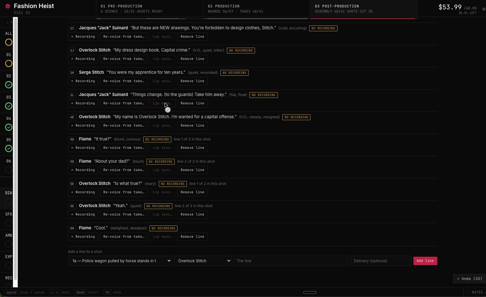

Every line of dialogue, by character. If a take's generated voice is wrong or drifts between
shots, swap it for the character's ElevenLabs voice, re-voice it from the take, remove the line, or
upload a recording (a voice actor, or you) and run a lip-sync pass. Add sound effects per shot
(several models, Kling by default) and room tone per scene from what's happening in it: rain,
city, a quiet workshop.

### 8. Rough cut and export

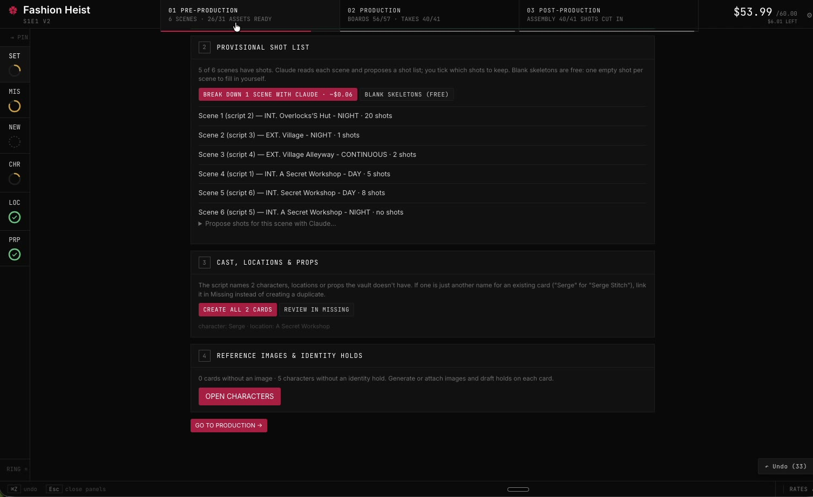

Play the whole episode as a rough assembly, with storyboards holding the places of shots not made
yet. When it's right, export:

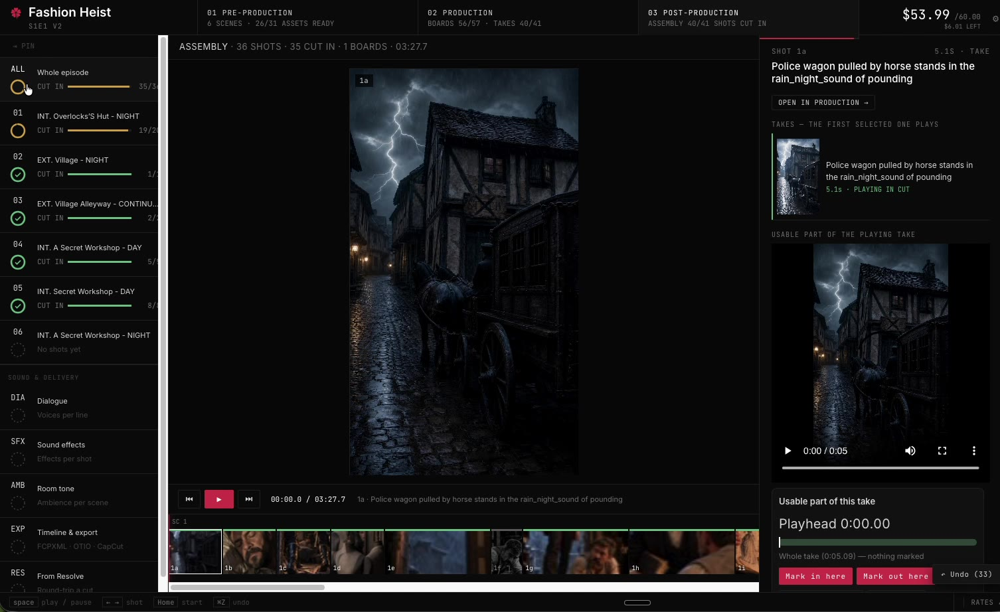

- **DaVinci Resolve**: an FCPXML timeline, with your media sorted into scene bins.
- **OpenTimelineIO**, or a **CapCut-ready folder**.

### 9. Remaster: prove it cheap, finish it premium

Make the whole episode first on a cheaper model (MiniMax H3 costs a fraction of Seedance 2.5),
cut it in Resolve, then bring the Resolve timeline back as a **remaster**. The app knows exactly
which clips you used and how long each one is, so you regenerate only those shots, at only those
lengths, on the premium model. You pay premium prices for the finished cut, not for every
experiment.

## What it costs

The app is free. Video, images, voices and the Claude helpers come from services you connect
with your own API keys, and you pay them directly, at their prices. The app never marks up a
price. There's no subscription to the app and no monthly credit allowance to use up before it
resets.

- **Every paid action shows its price first**, and anything over your threshold asks you to
  confirm the exact amount.
- **A spending cap per episode** that the app enforces.
- **A receipt for every take**: model, seconds, cost. The episode total is always in the corner.
- **A price watch** that tells you when a model you use gets cheaper.

## Install

You need **macOS**, **[Node.js 22 or newer](https://nodejs.org)** and
**[ffmpeg](https://ffmpeg.org)** (`brew install ffmpeg`).

```bash
git clone https://github.com/ShawnTheWriter/red-clover-studio.git
cd red-clover-studio
npm install
npm start
```

`npm start` opens the app in your browser at http://localhost:8099.

**On first run** the app asks where your projects should live: any folder, including one inside
Dropbox, Google Drive or iCloud. Then open **⚙︎ → Connections** and add the keys for the services
you want. Keys are saved on your computer only, in the app's `.env` file, and the app only ever
shows their last four characters.

## Services

| Service | What it powers | Needed? |
|---|---|---|
| [fal](https://fal.ai) | Video (MiniMax H3 / H3 Max, Seedance 2.5 / 2.0, Kling, Wan), GPT Image, lip sync, upscaling, sound effects | For video, yes |
| [Atlas Cloud](https://www.atlascloud.ai) | Seedance 2.5 (including 480p drafts and 1080p finish) and Seedance 2.0 Fast/Mini at Atlas's prices | Optional |
| [Sume](https://sume.com) | Seedance 2.5 / 2.0 (Standard, Fast, Mini) and MiniMax H3 / H3 Max at wholesale prices (per output second). Its price list is public, so promos show up in quotes and the cheapest route | Optional |
| [Comfy Router](https://comfy.org/platform/router/) | MiniMax H3, Seedance 2.5 and Nano Banana stills through Comfy's partner-model API (see below) | Optional |
| [Google Gemini](https://aistudio.google.com/apikey) | Storyboard and vault images (Nano Banana) | Recommended |
| [ElevenLabs](https://elevenlabs.io) | Character voices | Optional |
| [Anthropic](https://console.anthropic.com) or [OpenRouter](https://openrouter.ai) | Claude helpers (shot lists, holds, prompts) | Optional |

Without any keys you can still write, board with your own images, import clips you already have,
cut and export.

## Run it on Comfy

Red Clover can send video takes through the [Comfy Router](https://comfy.org/platform/router/),
Comfy's single API for partner models, so one Comfy key and one credit balance pay for the shot.
It was added for the Open Source Higgsfield challenge on the Comfy Developer Platform.

1. Make a key at [platform.comfy.org](https://platform.comfy.org/login) (API Keys → + New) and add
   credit in your Comfy workspace. Comfy sells credits at 211 per US dollar.
2. Add the key under **⚙︎ → Connections → Comfy Router**, or put `COMFY_UI_API_KEY=...` in `.env`.
3. In the video picker, choose **Comfy** in the VIA row. Comfy rows are opt-in: the cheapest-route
   setting compares fal and Atlas only and never moves a take onto Comfy by itself. Comfy's prices are
   typed in from its pricing page (read 2026-10-16), not checked live like fal's, and the app doesn't
   read your Comfy balance.

| Row | Mode | Price (Comfy's published rate) |
|---|---|---|
| MiniMax H3, 768P | Start frame | $0.1287 per second (measured: a 5 s take used 136 credits, $0.6445) |
| MiniMax H3, 2K | Start frame | $0.1859 per second |
| Seedance 2.5, 480p / 720p / 1080p | Start + end frames | about $0.33 per second at 720p (billed by token) |
| Seedance 2.5, 720p | References (images and video) | about $0.36 per second, estimate |

Storyboard and vault stills can run through Comfy too: pick **Nano Banana 2 · Comfy** or **Nano Banana Pro · Comfy**
as the still model. They are billed by token (about $0.09 for a 1K Nano Banana 2 image), and Comfy bills
refused prompts, so the app books them at a ceiling price.

How it works: the driver is [server/drivers/comfy.js](server/drivers/comfy.js). It submits to
`POST /v2/models/{provider}/{model}/requests`, polls `/status` until `COMPLETED`, fetches the
result and downloads the clip before Comfy's signed link expires. Stills and reference videos go
inline as data URIs, capped at the Router's 100 MiB request limit.

Known gaps: the Router returns no per-take charge, so takes are booked at the price above and the
spending cap works from that estimate. Check your Comfy balance to reconcile. H3 with a start
frame is proven on the live service; Seedance 2.5 frames and references follow Comfy's model pages
but have not been run live yet.

## Your files

Everything is plain folders and files you can open, back up or sync:

```
<projects folder>/<Series>/             series.json, series bible
<projects folder>/<Series>/<Episode>/   studio.json + 00_script … 05_delivery
```

Every edit can be undone (⌘Z). Undo never discards a take you paid for.

## DaVinci Resolve

Export the timeline as FCPXML into Resolve. The app also writes a Resolve script, found under
Workspace → Scripts, that sorts the media into scene bins. To bring an edit back, export your
Resolve timeline as FCPXML into the episode folder and use Post-production → From Resolve, or
Library → + Remaster from a Resolve cut.

## Status and known gaps

- Tested on macOS with Chrome. Windows and Linux: untested. **Windows testers wanted**: if you can try
  it, please open an issue with what happened.
- Some prices are estimates until a real bill comes back; those are marked "~" in the app. The Atlas 1080p
  finish and the Atlas Seedance 2.0 rows are in that group.
- Whether Atlas's content filter accepts realistic faces on Seedance 2.0 is untested; it accepts them on 2.5.
- Sume: a frames take has been run and billed exactly at the quote. Reference mode (and whether its filter accepts realistic faces) is still untested, and Sume's Kling and Wan models are not in the app yet.
- Modules (reusable shot recipes, previz and looks, shareable with other creators) have their
  places in the app but are not built yet.

## For developers

`npm test` runs every suite. [docs/DEVELOPMENT.md](docs/DEVELOPMENT.md) covers the architecture,
data model and history. The only runtime dependency is the Anthropic SDK; there is no build step.

## Licence

MIT — see [LICENSE](LICENSE). The sample project's story, characters and media are © Shawn Whitney
and are included for trying the app, not for reuse.

---

Made by Shawn Whitney for Red Clover Studios, built with [Claude Code](https://claude.com/claude-code).
